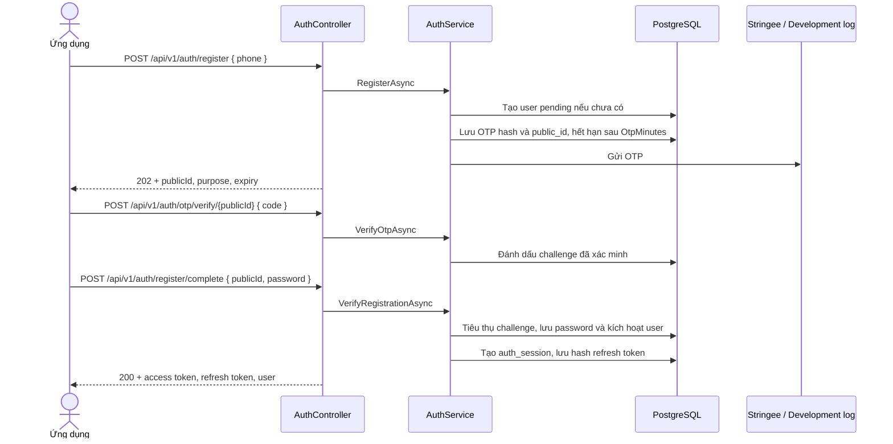

# Xác thực và phiên đăng nhập

Tài khoản dùng số điện thoại ở định dạng E.164, ví dụ `+84901234567`. Password và OTP được hash bằng ASP.NET Core `PasswordHasher<UserEntity>`; refresh token được lưu dưới dạng SHA-256 hash. Access token là JWT; refresh token là chuỗi ngẫu nhiên opaque.

## Sơ đồ đăng ký



Nếu số điện thoại chưa tồn tại, đăng ký tạo user `is_active = false`, `is_verified = false`, `verified_at = NULL`, `role = USER` và `permission_id = NULL`, với credential tạm thời không dùng được. OTP được xác minh riêng bằng challenge `publicId`; `/register/complete` sau đó đặt password, chuyển `is_verified` và `is_active` thành `true`, ghi `verified_at`, rồi cấp phiên. Password dài 8–128 ký tự, có chữ in hoa, chữ số và ký tự đặc biệt. Đăng ký lại cho tài khoản đang chờ xác minh dùng lại challenge hiện hành trong thời gian cooldown; sau cooldown mã mới được phát trên cùng challenge ID. Nếu phone đã thuộc tài khoản được xác minh, API trả `409 Conflict` (`auth_user_already_registered`) và hướng người dùng đăng nhập hoặc dùng chức năng quên mật khẩu; không tạo OTP/challenge mới.

API quản lý tài khoản ADMIN là luồng riêng: admin tạo tài khoản đã active bằng phone, password và permission profile; không gửi OTP. Đăng ký công khai vẫn tạo tài khoản role `USER` và yêu cầu xác minh OTP.

## API Auth

Tất cả request có body dùng JSON. Các endpoint trong bảng nằm dưới `/api/v1/auth`.

Response dạng JSON được bọc trong `ApiResponse<T>` với các trường `success`, `message`, `data`, `errors`, `code` và `traceId`; DTO thực tế nằm trong `data`. `204 No Content` không có body. Lỗi validation, exception nghiệp vụ, 401, 403 và 429 dùng cùng cấu trúc lỗi; ví dụ đầy đủ ở [Quy ước API](../api-conventions.md).

| Method và route | Đăng nhập | Request chính | Kết quả |
|---|---:|---|---|
| `POST /register` | Không | `phone` | `202 Accepted` + OTP challenge `publicId` |
| `POST /otp/verify/{publicId}` | Không | `code` và `publicId` trong route | `200 OK` + trạng thái challenge đã xác minh |
| `POST /otp/resend/{publicId}` | Không | `publicId` trong route | `202 Accepted`; phản hồi chung nếu challenge không thể gửi lại |
| `POST /register/complete` | Không | `publicId`, `password` | `200 OK` + token và user |
| `POST /login` | Không | `phone`, `password` | `200 OK` + token và user |
| `POST /refresh` | Không | `refreshToken` | `200 OK` + cặp token mới |
| `POST /logout` | Bearer JWT | Không có body | `204 No Content`; thu hồi session gắn với access token |
| `GET /me` | Bearer JWT | Không có body | `200 OK` + hồ sơ của tài khoản hiện tại |
| `POST /password/forgot` | Không | `phone` | `202 Accepted` + OTP challenge `publicId`; cùng response shape cho phone không tồn tại |
| `POST /password/reset` | Không | `publicId`, `newPassword` | `204 No Content` nếu challenge đã xác minh và đổi thành công |

Ví dụ đăng ký:

```http
POST /api/v1/auth/register
Content-Type: application/json

{
  "phone": "+84901234567"
}
```

Response đăng ký trả về một challenge. Đưa `publicId` lên URL, body chỉ chứa mã OTP:

```http
POST /api/v1/auth/otp/verify/5bbd5af0-d60c-4af8-bb7d-27b973bb8b74
Content-Type: application/json

{
  "code": "012345"
}
```

Sau khi OTP được xác minh, hoàn tất đăng ký bằng password:

```json
{
  "publicId": "5bbd5af0-d60c-4af8-bb7d-27b973bb8b74",
  "password": "Strong@Pass123"
}
```

Đặt lại mật khẩu dùng cùng bước xác minh OTP riêng, sau đó gửi:

```json
{
  "publicId": "e8bf6a2f-c2d3-48a8-b620-84cb1f495a30",
  "newPassword": "Reset@Pass456"
}
```

OTP phải gồm đúng 6 chữ số. Password lúc hoàn tất đăng ký và đặt lại phải dài 8–128 ký tự, có ít nhất một chữ in hoa, một chữ số và một ký tự đặc biệt. Số điện thoại phải đúng biểu thức E.164 theo sau bởi 8–15 chữ số, chữ số đầu khác 0.

## Đăng nhập, JWT và permission claim

Khi đăng nhập thành công, ứng dụng:

1. Tìm user theo số điện thoại và yêu cầu `is_active = true`, `is_verified = true`.
2. So sánh password với password hash.
3. Tạo `auth_sessions` mới và lưu SHA-256 của refresh token.
4. Tạo access JWT chứa user ID, `public_id`, phone, `session_id` và role. Claim function/action chỉ được thêm nếu user có role `ADMIN` cùng permission profile active.

Response `AuthResponseDto` có `accessToken`, `refreshToken`, `accessTokenExpiresAt` và `user`; đối tượng user có cả `id` nội bộ dạng số và `publicId`. Access token mặc định sống 15 phút; refresh session mặc định sống 30 ngày. Có thể thay đổi thời lượng bằng cấu hình JWT trong giới hạn được kiểm tra ở `JwtOptions`.

Mỗi request mang Bearer token đều kiểm tra session trong PostgreSQL: session phải chưa revoke, chưa hết hạn và user phải active, đã xác minh. Vì vậy logout, khóa tài khoản hoặc thu hồi session khiến access token hiện có không còn được chấp nhận, dù thời hạn JWT chưa kết thúc.

## Refresh token và logout

- Refresh token chỉ dùng một lần: endpoint `/refresh` thu hồi session cũ có điều kiện rồi tạo session/token mới.
- Cập nhật có điều kiện trong database ngăn hai request đồng thời cùng dùng thành công một refresh token.
- `/logout` thu hồi session được xác định bởi claim `session_id` và user ID trong access token.
- Đổi mật khẩu thu hồi mọi session active của tài khoản.

Gửi access token trong header:

```http
Authorization: Bearer <access-token>
```

Refresh token không gửi trong header này; gửi trong body endpoint `/api/v1/auth/refresh`.

## OTP đặt lại mật khẩu

`POST /password/forgot` tạo OTP challenge với purpose `PASSWORD_RESET` nếu user active và verified tồn tại. Response luôn có cùng cấu trúc cho số điện thoại có hoặc không có tài khoản. `POST /otp/verify/{publicId}` kiểm tra mã cho challenge đó, sau đó `/password/reset` chỉ chấp nhận challenge đã xác minh, còn hạn và đúng purpose. Challenge được tiêu thụ một lần; cập nhật mật khẩu và thu hồi session diễn ra trong transaction.

OTP cũ còn hiệu lực cùng purpose bị hết hạn khi tạo OTP mới. Hệ thống lưu giá trị OTP đã hash, số lần nhập sai, thời điểm tạo/hết hạn/xác minh và purpose (`registration` hoặc `password_reset`). Sau 5 lần nhập sai, OTP hiện tại hết hiệu lực và cần yêu cầu gửi mã mới.

## OTP đăng ký và password ban đầu

OTP được lưu dưới dạng hash và gắn với `publicId` duy nhất. Mã hết hạn theo `Jwt:OtpMinutes`, chỉ xác minh một lần và bị khóa sau 5 lần nhập sai. Đăng ký và đặt lại mật khẩu đều phải gọi `/otp/verify/{publicId}` trước bước hoàn tất tương ứng. Trong Development, SMS đang tạm tắt và OTP dùng mã `012345`, đồng thời được ghi vào application log. Ngoài Development, OTP là chuỗi số ngẫu nhiên 6 chữ số và được gửi qua SMS. Hệ thống chỉ phát lại OTP cùng purpose sau mỗi 30 giây; phản hồi gửi lại không tiết lộ challenge có tồn tại hay không.

Người dùng tự chọn password mạnh trong request hoàn tất đăng ký hoặc đặt lại mật khẩu. Backend không gán mật khẩu chung sau khi xác minh; `123456` chỉ được dùng cho dữ liệu seed Development.

## OTP qua SMS

Interface `IOtpSmsSender` tách vận chuyển SMS khỏi nghiệp vụ AuthService:

- Development luôn dùng `DevelopmentOtpSmsSender`, mã `012345` được ghi trong application log; cấu hình Stringee bị bỏ qua khi tích hợp đang tạm dừng.
- Ngoài Development, có đủ `Stringee:ApiKeySid`, `Stringee:ApiKeySecret`, `Stringee:BrandName`: dùng `StringeeOtpSmsSender`.
- Production thiếu một trong ba giá trị Stringee: ứng dụng dừng lúc khởi động với lỗi cấu hình.

Ở Development hãy tìm dòng `Development OTP for ...` trong log. Không dùng triển khai log để gửi mã cho người dùng thật. Cấu hình SMS chi tiết nằm trong [Cấu hình AuthModule](configuration.md).

## Giới hạn chống gửi dồn

Các route Auth áp dụng sliding window tối đa 10 request/IP/phút. Khi vượt ngưỡng API trả 429. Đây là giới hạn theo địa chỉ IP cấu hình trong middleware, không phải hạn mức riêng theo từng số điện thoại.
