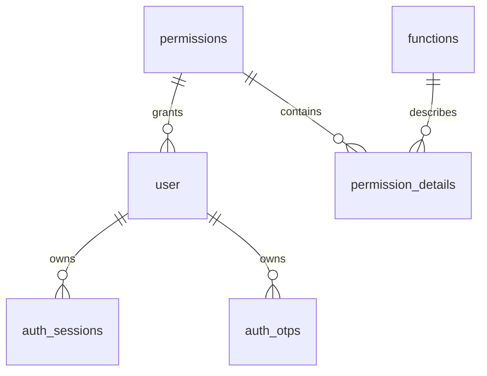

# Mô hình dữ liệu AuthModule

Trang này mô tả sáu entity/bảng thuộc AuthModule và catalog mặc định. Lệnh EF Core, lifecycle migration và môi trường chạy nằm trong [Cơ sở dữ liệu và migration toàn hệ thống](../persistence-and-migrations.md).

## Sáu bảng

| Bảng | Vai trò | Trường và ý nghĩa |
|---|---|---|
| `user` | Hồ sơ đăng nhập | `id` khóa nội bộ; `public_id` ID công khai; `phone` duy nhất; `password` password hash; `is_active` tài khoản đang được phép hoạt động; `is_verified` trạng thái xác minh; `verified_at` thời điểm tài khoản được xác minh; `role` (`USER`/`ADMIN`); `permission_id` chỉ dùng cho `ADMIN`; `last_active_at`; `created_at` |
| `auth_sessions` | Theo dõi phiên đăng nhập và refresh token | `user_id` chủ sở hữu; `refresh_token` SHA-256 hash; `created_at`, `expired_at` và `revoked_at` |
| `auth_otps` | Lưu OTP đăng ký/reset | `public_id` làm challenge ID cho API; `user_id`; `code` hash; `purpose`; `failed_attempts`; `created_at`, `expired_at`, `verified_at` |
| `permissions` | Permission profile chứa các grant cho user `ADMIN` | `status`, `name`, `description` |
| `permission_details` | Grant một action cho permission profile | `permission_id`, `function_id`, `action` |
| `functions` | Danh mục nhóm chức năng API và action tương ứng | `name_vn`, `name_en`, `actions` kiểu PostgreSQL `text[]` |

## Quan hệ



- `USER` luôn có `permission_id = NULL`; `ADMIN` phải tham chiếu một permission profile.
- `is_verified` được đặt thành `true` và `verified_at` được ghi cùng thời điểm khi OTP đăng ký đã xác minh và tài khoản hoàn tất đăng ký; đổi số điện thoại đặt `is_verified = false`, `verified_at = NULL`. Database ràng buộc hai trường phải đồng bộ. `is_active` độc lập để quản trị viên có thể tạm khóa/mở lại tài khoản đã xác minh.
- `user.verified_at` lưu trạng thái xác minh lâu dài của tài khoản; `auth_otps.verified_at` chỉ lưu lúc một challenge OTP cụ thể được xác minh.
- Một permission profile có thể gán cho nhiều user `ADMIN`; mỗi user tham chiếu tối đa một profile.
- Một user có thể có nhiều session và OTP. Xóa user cascade xóa session/OTP.
- `permission_details` nối một permission với một function/action.
- Xóa permission hoặc function cascade xóa các grant tương ứng.

## Khóa và ràng buộc

- `user.public_id`, `user.phone`, `auth_otps.public_id`, `permissions.name`, `functions.name_en` có unique index. Client dùng `auth_otps.public_id` cho bước xác minh OTP và bước hoàn tất đăng ký/đặt lại mật khẩu.
- `permission_details` unique theo tổ hợp `permission_id + function_id + action`, tránh grant lặp.
- `auth_sessions.refresh_token` có unique index; `auth_otps` có index theo `user_id`, `purpose`, `created_at` để tìm OTP gần nhất.
- Password và OTP dùng ASP.NET Core `PasswordHasher`; refresh token lưu SHA-256. Không lưu ba giá trị này dạng rõ.
- Timestamp map thành PostgreSQL `timestamp with time zone`; service tạo thời gian UTC.

## Permission catalog được nạp

Migration `AddUserVerificationState` đảm bảo có `user.is_verified` và `user.verified_at`, kể cả khi `is_verified` đã được tạo thủ công trước đó, rồi thêm check constraint giữ hai trường nhất quán. Dữ liệu cũ được backfill: user đang active được xem là đã xác minh (thời điểm lấy từ OTP đăng ký gần nhất nếu OTP đó đã được xác minh, hoặc `created_at` nếu OTP đó chưa xác minh hay chưa có); user inactive chỉ được xem là đã xác minh nếu OTP đăng ký gần nhất đã được xác minh.

Migration `LimitOtpVerificationAttempts` thêm `auth_otps.failed_attempts`; một mã OTP hết hiệu lực sau 5 lần nhập sai.

`SeparateUserRoleAndPermissions` thêm `user.role`, chuyển user đang gắn profile `ADMIN` thành role `ADMIN`, bỏ profile `USER`, đổi profile `ADMIN` thành `ADMIN_DEFAULT`, và thêm check constraint role/permission. `SetAuthEnumsUppercase` chuẩn hóa các enum trong PostgreSQL thành mã tiếng Anh in hoa (`REGISTRATION`, `PASSWORD_RESET`, `ACTIVE`, `INACTIVE`); converter trả nhãn tiếng Việt cho role trong JSON. `AuthPermissionCatalogSeeder` chạy sau migration trong Development và cập nhật function catalog. Bộ grant mặc định chỉ được thêm khi profile `ADMIN_DEFAULT` được tạo lần đầu; lần chạy sau không khôi phục grant bị gỡ. `AuthDevelopmentAdminAccountsSeeder` tạo hai admin fixture, còn `AuthDevelopmentAdminSeeder` có thể tạo thêm admin local theo User Secrets; cả hai chỉ chạy trong Development.

| Permission | Grant mặc định |
|---|---|
| `ADMIN_DEFAULT` | `users:read`, `users:create`, `users:update` |

Function catalog hiện có `users` với các action `read`, `create`, `update`, tương ứng policy đang gắn trên controller. JWT chỉ tạo claim permission cho user role `ADMIN` có permission profile đang hoạt động. Chi tiết xem [User và permission](users-and-permissions.md).

Migration và `AuthPermissionCatalogSeeder` tạo profile `ADMIN_DEFAULT`. Trong Development, tài khoản ADMIN fixture `+12025550190` và `+12025550191` dùng mật khẩu `123456`, giống user mẫu; có thể cấu hình thêm một admin riêng bằng `Seed:AdminPhone` và `Seed:AdminPassword`. Startup Production không chạy runtime seeder; dữ liệu catalog production phải có trong migration/release SQL và tài khoản quản trị cần được bootstrap qua quy trình kiểm soát riêng.

`AuthDevelopmentSampleDataSeeder` bổ sung 24 user mẫu, 44 OTP và 40 session lịch sử ở Development. Bộ mẫu có user active, chờ xác minh và đã xác minh nhưng đã tắt. Password mặc định là `123456`; chỉ 16 user active đăng nhập được. OTP/session đều hết hạn. Seeder bỏ qua dữ liệu phụ của số điện thoại đã tồn tại, nhưng sẽ đặt lại password mẫu về `123456`; chạy lặp không nhân bản dữ liệu.

## Truy vấn kiểm tra catalog

```sql
SELECT p.name AS permission, f.name_en AS function, pd.action
FROM permission_details pd
JOIN permissions p ON p.id = pd.permission_id
JOIN functions f ON f.id = pd.function_id
ORDER BY p.name, f.name_en, pd.action;
```

## Thay đổi schema AuthModule

Entity nằm trong `Modules/AuthModule/Entities/`; model được tập hợp vào `AppDbContext`. Khi thay đổi entity, tạo migration mới theo [quy trình migration toàn hệ thống](../persistence-and-migrations.md). Migration `Down()` hiện tại xóa sáu bảng trên cùng dữ liệu của chúng; cần đánh giá dữ liệu trước khi rollback.
