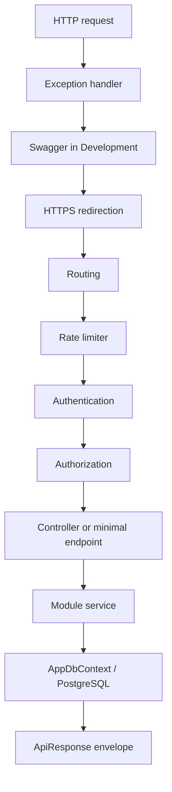

# Kiến trúc hệ thống

## Mục tiêu tổ chức

Ứng dụng là ASP.NET Core Web API chạy trên .NET 10, kết nối PostgreSQL bằng Entity Framework Core/Npgsql. Mã nguồn chia thành:

- `Program.cs`: composition root, nơi ghép cấu hình, dependency injection, middleware và endpoint.
- `Modules/`: tính năng theo module. Mỗi module sở hữu controller, DTO, service và quy tắc nghiệp vụ liên quan.
- `Shared/`: hạ tầng dùng lại giữa các module như response, exception, validation, database và migration.

Quy tắc phụ thuộc: module có thể dùng `Shared`; `Shared` không nên phụ thuộc vào nghiệp vụ cụ thể của một module.

## Bản đồ thư mục

```text
DotNetSkeleton/
├── Program.cs
├── appsettings*.json
├── Properties/launchSettings.json
├── Modules/
│   ├── AuthModule/
│   │   ├── Authorization/
│   │   ├── Configuration/
│   │   ├── Controllers/
│   │   ├── DTOs/Requests/
│   │   ├── DTOs/Responses/
│   │   ├── Entities/
│   │   └── Services/Interfaces/
│   └── ExampleModule/
│       ├── Controllers/
│       ├── DTOs/Requests/
│       ├── Validators/
│       ├── Entities/
│       ├── ExampleRepository.cs
│       ├── ExampleService.cs
│       └── IExampleService.cs
└── Shared/
    ├── Api/
    ├── Configurations/
    ├── Controllers/
    ├── Exceptions/
    ├── Extensions/
    ├── Middlewares/
    ├── Persistence/
    └── Validation/
```

`ExampleModule` là module mẫu đang có trong repository. Cấu trúc bên trong các module hiện chưa hoàn toàn đồng nhất; khi thêm module mới, dùng convention thống nhất trong [Phát triển module](module-development.md).

## Các thành phần chính

### Composition root — `Program.cs`

`Program.cs` đăng ký và ráp các thành phần theo thứ tự:

1. `AddAuthModule(...)` đăng ký controllers và dependency của AuthModule.
2. `AddSharedApi()` đăng ký exception/validation response dùng chung.
3. `AddSwaggerDocs()` đăng ký OpenAPI và Swagger.
4. `AddDatabase(...)` đăng ký `AppDbContext` với PostgreSQL.
5. `AddSeeders()` đăng ký các seeder được chọn cho ứng dụng.
6. `AddApplicationServices()` đăng ký service/validator hiện được dùng bởi module mẫu.
7. Sau `builder.Build()`, ứng dụng thêm middleware rồi map controllers và các endpoint tiện ích.

Đây là nơi composition root chọn module nào được bật và đăng ký. Logic nghiệp vụ không nên đặt trực tiếp trong `Program.cs`.

### Modules

Module gom các thành phần theo chức năng thay vì gom toàn bộ controller/service vào một folder dùng chung. Controller chuyển HTTP request thành lời gọi service; service giữ quy tắc nghiệp vụ; DTO định nghĩa API contract; entity biểu diễn dữ liệu persistence.

AuthModule đã được tách thành controller/service/request-response DTO/entity. ExampleModule minh họa module nhỏ hơn. Shared helpers có thể được dùng bởi mọi module mà không cần sao chép.

### Shared

`Shared/Api` định nghĩa response JSON; `Shared/Controllers` cung cấp controller base; `Shared/Exceptions` xử lý lỗi; `Shared/Validation` tập hợp luật dùng chung. `Shared/Persistence` chứa EF Core context, migrations và seeder infrastructure. Chi tiết từng class nằm trong [Các thành phần Shared](shared-components.md).

## Request pipeline



Các middleware được cài theo đúng thứ tự trong `Program.cs`: exception handler, Swagger, HTTPS redirection, routing, rate limiter, authentication và authorization. Controller endpoints được map sau các middleware này.

`UseRateLimiter()` đứng trước authentication/authorization trong cấu hình hiện tại. AuthModule gắn policy rate limit lên các route auth; policy hiện chia quota theo IP.

## Development và Production

| Hành vi | Development | Production |
|---|---|---|
| Swagger | Bật | Tắt |
| EF migration khi app start | Có, qua `DatabaseSeeder.RunAsync()` | Không |
| Seeder qua startup | Có, với các seeder đăng ký | Không |
| OTP SMS | Tạm thời không gọi Stringee; dùng `012345` và ghi vào log | OTP ngẫu nhiên, gửi qua Stringee nếu cấu hình đầy đủ |
| Secret | Có thể dùng User Secrets | Dùng environment/secret manager |

Chi tiết môi trường nằm ở [Cấu hình và chạy hệ thống](system-configuration.md) và [Cấu hình AuthModule](auth-module/configuration.md).

## Hướng phát triển

- Giữ `Program.cs` làm nơi lắp ráp ứng dụng, không thêm business rules vào đó.
- Module mới dùng `ApiControllerBase`, `ApiResponse<T>`, `AppException` và các luật validation trong `Shared`.
- Mỗi module đăng ký service và validator của nó qua extension/DI rõ ràng.
- Thay đổi schema bằng EF migration; không sửa database trực tiếp như một thay đổi triển khai lâu dài.
- DTO là ranh giới API; không trả entity persistence trực tiếp trong các endpoint mới.
